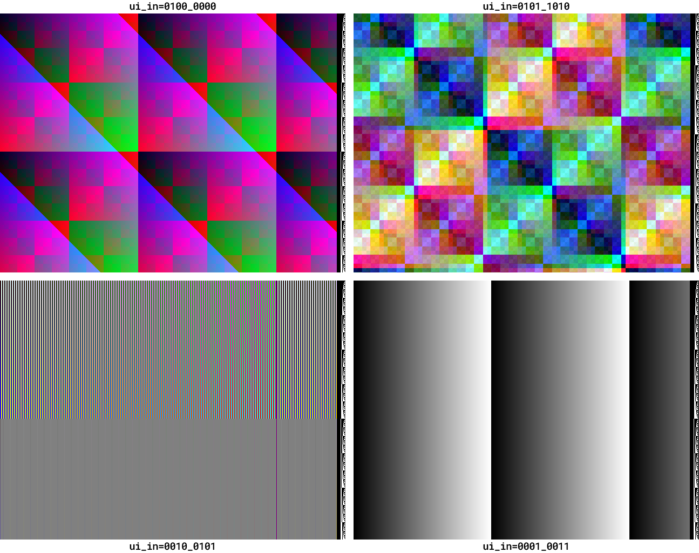
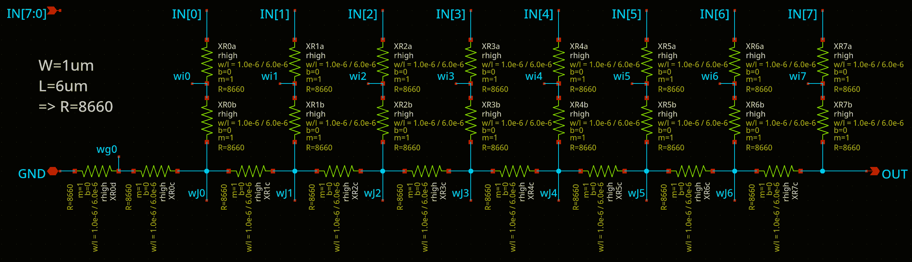
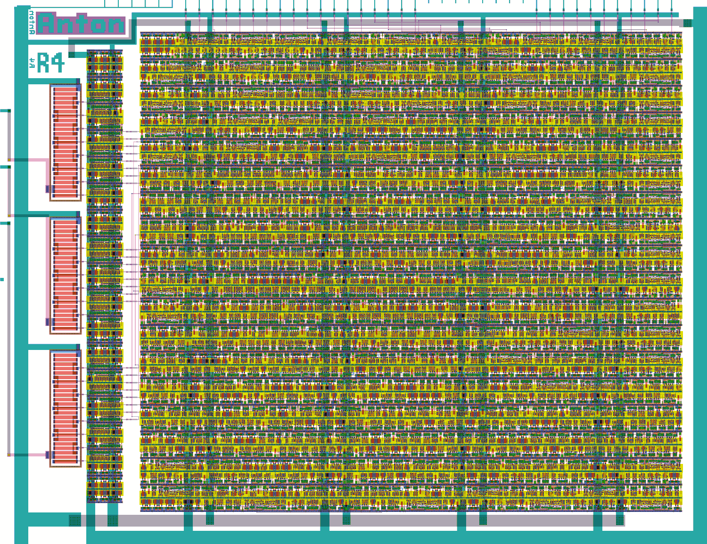

<!---

This file is used to generate your project datasheet. Please fill in the information below and delete any unused
sections.

You can also include images in this folder and reference them in the markdown. Each image must be less than
512 kb in size, and the combined size of all images must be less than 1 MB.
-->

## Overview

**For a quick-start guide on simply testing the RDAC performance in this design using an oscilloscope, just see the heading "1. Measure analog outputs on an oscilloscope". I intend to have results collected in the [TTIHP0p3-Antonalog](https://docs.google.com/spreadsheets/d/1ijWdzJL9L4ZYqBhKCiZMeHCRW9pjFe_lTgYaaWa5nSQ/edit?gid=0#gid=0) sheet of my "Anton's Tiny Tapeout silicon testing" Google Sheet.**

This mixed-signal design uses 3 instances of an 8-bit RDAC to produce analog voltage outputs for each of the red, green, and blue channels of a video display. It was submitted to [TTIHP0p3](https://app.tinytapeout.com/shuttles/ttihp0p3), and the specific commit workflow was: https://github.com/algofoogle/ttihp0p3-antonalog/actions/runs/15096423059

The output range of the DACs is 0-1.2V (or whatever core voltage you provide to the chip).

This design provides simple ways to just test the performance/linearity/slew of the DACs, but also includes a digital control block that generates various VGA display test patterns, some of which are demonstrated above. Besides the analog outputs, the `uo_out` port is also compatible with the [Tiny VGA PMOD](https://store.tinytapeout.com/products/Tiny-VGA-Pmod-p678647356) (providing just RGB222 instead of the design's full RGB888 capability).

NOTE: The output impedance of the DACs is about 8660&ohm; (i.e. internally, the RDACs use R &approx; 8660&ohm;).

## Quick start

Take your pick from the options below:

1.  Use an oscilloscope, with the design's modes for measuring linearity or slew rate for any/all of the analog RGB outputs.
2.  Plug in a Tiny VGA PMOD and just see the VGA pattern generator doing something.
3.  Generate full RGB888 images on a VGA display by buffering/shifting the analog outputs with op-amps.

### 1. Measure analog outputs on an oscilloscope

Basic setup common to all measurements done with a scope:

1.  To sync to the start of each frame, set your scope to trigger on the rising edge of `vblank_out` (`uio_out[0]`). 
2.  Probe any (or all) of the analog outputs: `r` (red, on `ua[0]`), `g` (green, on `ua[1]`), or `b` (blue, on `ua[2]`).
3.  Supply a 25MHz clock; this will conveniently make each DAC output sample 40ns in duration.
4.  Set `ui_in` to one of the test modes as described below (`00010011`, i.e. 0x13, is good to start with).
5.  Assert reset.

During reset, the design will latch the test mode specified by `ui_in`. Some of these modes include:

*   `00010011` (0x13): All 3 analog output channels ramp up together at a rate of 40ns per level, i.e. they all start at 0 (0V), increment per-pixel to eventually reach 255 (~1.2V), then after 256 clocks (10.24&micro;s) will start again from 0. This allows simple measurement of:

    *   The slew rate from one level to the next
    *   The full-swing rate back down to 0
    *   Any non-linearity or discontinuities in the ramp

*   `00010000` (0x10): Red ramps at the full per-pixel rate, Green ramps per-line, and Blue ramps per-frame. In this mode, cross-talk between channels might become evident.
*   `00100000` (0x20): "Bars" mode: Same as above (0x10) but the output is inverted on every odd pixel. This allows measurement of big swings both up and down.

NOTE: All modes output the line number, as a binary pattern (black and white pixels), in the last 16 pixels of each line.

### 2. Tiny VGA PMOD output

1.  Attach a [Tiny VGA PMOD](https://store.tinytapeout.com/products/Tiny-VGA-Pmod-p678647356) to the `uo_out` port, and plug in a VGA monitor.
2.  Supply a 25MHz clock.
3.  Set `ui_in` to (say) `01010000` (0x50).
4.  Assert reset.
5.  Expect to see a pattern like the one shown in the top-right screenshot above, though with much-reduced bit depth (per the limited RGB222 output of the Tiny VGA PMOD).

### 3. Full analog VGA display

1.  Use 3 op-amps on the analog outputs to both buffer them (matching 75&ohm; termination of the VGA monitor's colour channels) and level-shift them to 0-0.7V (instead of 0-1.2V). The [OPA3355](https://www.ti.com/product/OPA3355) is a good choice: it comprises 3 op-amps that are fast enough for VGA, and are (moderately) rail-to-rail to use with (say) a single 3.3V supply.
2.  Optionally buffer the `hsync` and `vsync` outputs and use (say) 50&ohm; in series with the respective VGA monitor inputs.
3.  Per "2. Tiny VGA PMOD output" above, set up the design and select a `ui_in` mode.

## Test modes on `ui_in`

There are lots of different options for the `ui_in` test modes, including some which are intentionally sensitive to a *change* in `ui_in` value after initial latching at reset. For details, see [my explanation of the digital control block's inputs](https://github.com/algofoogle/journal/blob/master/0215-2024-08-21.md#explanation-of-digital-block-control-inputs), but here's a quick version of the more-useful modes:

*   `00010000`: Red channel ramps per pixel, Green channel ramps per line, Blue channel ramps per frame.
*   `00010011`: All 3 channels ramp per pixel (i.e. grey ramps). See bottom-right screenshot above.
*   `00100000`: "Bars" mode: Same as `00010000` except that every odd-numbered pixel gives an inverted output. Note that the 4 LSBs set different options (as they do for the above 2 modes); see bottom-left screenshot above.
*   `01000000`: "Classic" XOR mode, seen in the top-left screenshot.
*   `01010000`: "New" XOR mode, seen in the top-right screenshot.
*   `01100000`: A static (non-animated) version of the "New" XOR mode.
*   `00000000`: Pass-through mode: In this mode, *after reset* any value presented on `ui_in` will be passed directly through to all 3 DACs. NOTE: If `ui_in[1]` is 0, then the output is ungated, otherwise if 1 the output is gated to only be passed through during the visible portion of each frame.

## Design

Each of the 3 DAC instances uses a typical R2R DAC, where R &approx; 8660&ohm;.

In the layout above:

*   There is the [main digital control block](https://github.com/algofoogle/ttihp0p3-antonalog/blob/main/verilog/rtl/controller.v) occupying most of the area (i.e. on the right).
*   To the left of that is a thin column of digital layout which just implements uniform drivers for the RGB888 signals into the DACs [using `sg13g2_buf_8` cells](https://github.com/algofoogle/ttihp0p3-antonalog/blob/3e1e53678840aedc78f23b1af0a6047717b6d08f/verilog/rtl/rgb_buffers.v#L18).
*   To the left of that are the 3 instances of the RDAC layout. It uses resistors of matched sizes, i.e. where "2R" is required, there is a pair of "R"-sized resistors in series.

## Background

This was my first attempt at a custom layout and mixed-signal design on IHP SG13G2.

I leaned heavily on https://github.com/htfab/ttihp0p3-r2r-dac for the analog layout parts of this, and the digital control block is from my earlier [tt08-vga-fun](https://tinytapeout.com/chips/tt08/tt_um_algofoogle_tt08_vga_fun) project. For my related VGA DAC projects, see:

*   [Write-up](https://github.com/algofoogle/journal/blob/master/0226-2025-02-20.md) on my original [TT06 analog VGA driver](https://tinytapeout.com/runs/tt06/tt_um_algofoogle_tt06_grab_bag).
*   [TT08 VGA FUN!](https://tinytapeout.com/chips/tt08/tt_um_algofoogle_tt08_vga_fun) -- An alternative design trying out current-steering and current-switching DAC designs.
*   [TTSKY25a Analog VGA CSDAC experiments](https://tinytapeout.com/chips/ttsky25a/tt_um_algofoogle_vga_matrix_dac) -- A current-switching DAC *matrix*, first attempt.
*   [TTSKY25b Analog VGA CSDAC experiments](https://tinytapeout.com/chips/ttsky25b/tt_um_algofoogle_vga_matrix_dac) -- 2nd attempt at the DAC matrix, fixing some performance issues with the TTSKY25a version. In particular, this version has better parasitics and a 'registered' mode.
